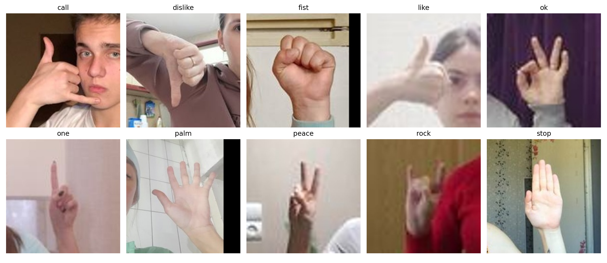
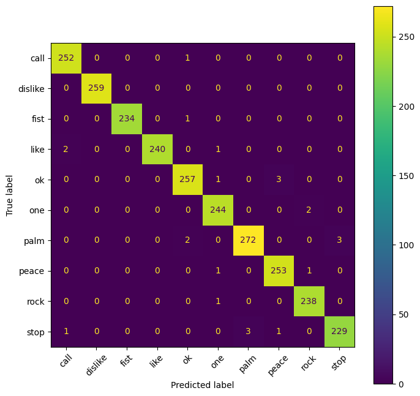
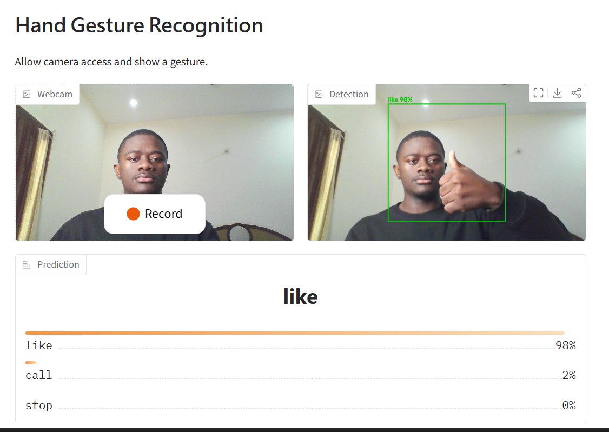
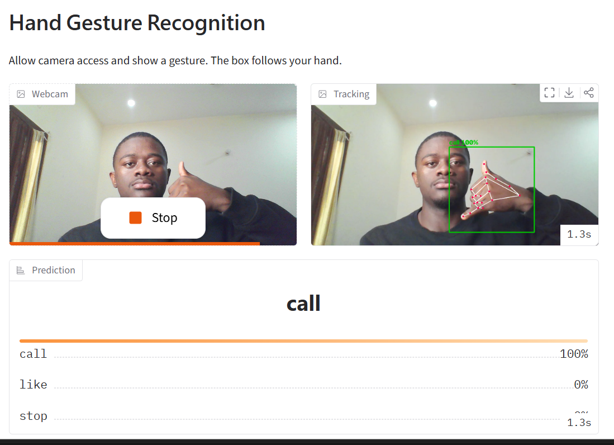

# Hand Gesture Recognition System

Real-time hand tracking and gesture classification from a webcam, built with deep learning.

A MobileNetV3 classifier, fine-tuned on a sample of the HaGRID dataset, recognises ten hand gestures. MediaPipe finds and follows the hand in every frame, so the gesture is recognised wherever the hand appears, with no stationary box.

> Summer Internship Project, by Rinwi Prosper Jibuin

## Features

- Hand tracking with 21 landmarks (MediaPipe HandLandmarker)
- Gesture classification with a fine-tuned MobileNetV3-Large (PyTorch)
- Smoothed box and predictions, so the display is steady
- Browser frontend (Gradio) and a desktop window (OpenCV)
- A fixed-box version for comparison with the tracking version

**Gestures:** call, dislike, fist, like, ok, one, palm, peace, rock, stop

## How it works

```
Webcam frame -> MediaPipe finds the hand -> padded, smoothed box -> crop
             -> MobileNetV3 classifier -> average of last 5 predictions -> label
```

## Technologies

Python 3.12, PyTorch, torchvision (MobileNetV3), MediaPipe, OpenCV, Pillow, NumPy, Gradio, scikit-learn, Matplotlib, Google Colab, Kaggle.

## Project structure

```
.
├── hand_gesture_training.ipynb   Colab notebook: data prep, training, evaluation
├── gesture_model.pt              Trained model (weights, class names, crop margin)
├── tracker.py                    Hand tracking + classification + smoothing
├── app.py                        Gradio app with hand tracking
├── live_cam.py                   OpenCV window with hand tracking
├── app_fixed_box.py              Gradio app with a fixed box (baseline)
├── requirements.txt
└── figures/                      Images used in the report
```

## Setup (Windows)

Run each command on its own line from the project folder.

```
py -3.12 -m venv gesture-env
gesture-env\Scripts\Activate.ps1
python -m pip install -r requirements.txt
```

## Run

```
python app.py             # browser app with hand tracking
python live_cam.py        # desktop window with hand tracking (press q to quit)
python app_fixed_box.py   # browser app with a fixed box
```

The browser apps print a local address (usually http://127.0.0.1:7860). Open it and allow camera access. On the first run, the MediaPipe hand model (`hand_landmarker.task`) is downloaded automatically, so an internet connection is needed once.

## Training your own model

1. Open `hand_gesture_training.ipynb` in Google Colab and choose a GPU runtime.
2. Upload your Kaggle API token (`kaggle.json`) when asked. Never commit this file.
3. Run the cells in order. The last cell downloads `gesture_model.pt`; place it in the project folder.

## Dataset

Trained on a 384p sample of [HaGRID](https://github.com/hukenovs/hagrid) (HAnd Gesture Recognition Image Dataset), released under CC BY-SA 4.0. The dataset is not included in this repository.

Kapitanov, A., Makhlyarchuk, A., and Kvanchiani, K. (2022). *HaGRID - HAnd Gesture Recognition Image Dataset*. arXiv:2206.08219.

## Results

The model was evaluated on a held-out test set of 2,502 images from people who were not used in training (the data is split by person).

| Metric | Value |
|---|---|
| Gesture classes | 10 |
| Train / validation / test images | 12,558 / 2,503 / 2,502 |
| Best validation accuracy | 98.9% |
| **Test accuracy** | **99.04%** |
| Training time | 19 minutes (Google Colab GPU) |

### Per-gesture test results

| Gesture | Precision | Recall | F1-score | Test images |
|---|---|---|---|---|
| call | 0.99 | 1.00 | 0.99 | 253 |
| dislike | 1.00 | 1.00 | 1.00 | 259 |
| fist | 1.00 | 1.00 | 1.00 | 235 |
| like | 1.00 | 0.99 | 0.99 | 243 |
| ok | 0.98 | 0.98 | 0.98 | 261 |
| one | 0.98 | 0.99 | 0.99 | 246 |
| palm | 0.99 | 0.98 | 0.99 | 277 |
| peace | 0.98 | 0.99 | 0.99 | 255 |
| rock | 0.99 | 1.00 | 0.99 | 239 |
| stop | 0.99 | 0.98 | 0.98 | 234 |

`dislike` and `fist` were classified perfectly. The lowest scores (F1 of 0.98) belong to `ok` and `stop`. The test images come from the same dataset as the training images, so accuracy on a live webcam may be lower.

### Sample images



### Confusion matrix



### Fixed box vs hand tracking

| Fixed box (`app_fixed_box.py`) | Hand tracking (`app.py`, `live_cam.py`) |
|---|---|
|  |  |

In live testing, the tracking version only produced an output when a hand was visible to the webcam. The fixed-box version gave reliable results only when the hand was inside the box, and it still showed predictions when no hand was in the frame.

## Author

Rinwi Prosper Jibuin
